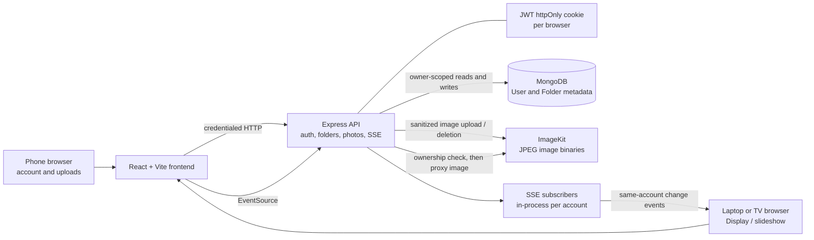

# Architecture

## Technology and responsibilities

- **React + Vite + React Router** implement the responsive account, folder, upload, display, and slideshow pages.
- **Express on Node.js** provides the JSON API, cookie authentication, protected photo proxy, and SSE route.
- **MongoDB + Mongoose** store account data and owner-scoped folders with embedded photo metadata.
- **ImageKit** stores image binaries; **Sharp** decodes, validates, orients, and converts uploaded images to JPEG before storage.
- **bcryptjs and JWT** support password/answer hashing and signed browser sessions. The JWT is delivered only through an httpOnly cookie.

The split keeps UI rendering and interaction in the browser, authorization and input checks on the API, structured metadata in MongoDB, and image objects in dedicated image storage.

## Component diagram

In development, Vite proxies `/api` to the Express server. A separate frontend/API deployment uses the configured API base URL, CORS allowlist, and cookie settings.

## Frontend and backend flow

`client/src/api.js` is the frontend's HTTP wrapper. It sends credentials, handles JSON and multipart requests, and translates API errors. `AppDataProvider` obtains the current account and folder list, keeps them in React state, and exposes refresh/update helpers. Pages share that state for folder editing and displaying.

`server/src/server.js` loads environment configuration, connects to MongoDB, then starts Express. `server/src/app.js` configures CORS, JSON parsing, cookies, health reporting, routes, and error responses. Protected folder routes run `requireAuth` before controllers; controllers apply ownership filters to folder/photo queries.

## Authentication

1. Signup validates name/email/password/security-question data. Password and normalized answer are separately hashed with bcrypt.
2. Login compares the password hash and sets an httpOnly cookie containing a signed JWT. Session lifetime is seven days; logout clears the cookie.
3. Protected requests verify the JWT and load the account from MongoDB. The client does not select or send an owner ID for authorization.
4. Password recovery returns the selected question only for configured users. Verification compares a bcrypt hash, then returns a random short-lived token while MongoDB stores only its SHA-256 hash. Password reset atomically consumes the unexpired token. Login, lookup, verification, and reset routes are rate-limited as configured in `server/src/routes/authRoutes.js`.

Older accounts without question data remain able to log in but cannot self-serve a reset through this flow.

## Data models and ownership

- **User** (`server/src/models/User.js`): name, unique normalized email, password hash, optional security question/answer hash, reset-token hash/expiry, timestamps.
- **Folder** (`server/src/models/Folder.js`): `owner` ObjectId referencing a User, folder name, duration, timestamps, and an embedded array of photos.
- **Embedded photo**: original filename, protected app URL, ImageKit file ID and URL, MIME type, processed size, width, height, optional legacy disk key, and creation timestamp.

Relationship: **one User owns many Folder documents; each Folder embeds zero or more photo metadata records.** Photo binaries are not embedded in MongoDB. Folder lists and all folder/photo operations are filtered by the authenticated owner. The supported folder durations are 3, 5, 7, 10, or 15 seconds.

## ImageKit upload and retrieval

1. An authenticated browser posts multipart field `photos` to `POST /api/folders/:folderId/photos`.
2. Multer buffers images and limits a file to 10 MB and a request to 10 files. The file filter requires an `image/*` MIME type.
3. Sharp decodes the actual bytes, rejects decode failures and images over 40 million pixels, applies orientation, and re-encodes JPEG at the configured quality. Re-encoding removes EXIF metadata from the stored result.
4. The API uploads each JPEG to ImageKit. It records file ID, provider URL, protected application URL, and resulting image metadata in the owner's folder in MongoDB.
5. On a database/save error after external uploads, the handler attempts to delete those newly uploaded ImageKit files. This is cleanup-on-failure, not a distributed transaction.
6. On retrieval, `GET /api/photos/:photoId` finds an owned photo, then proxies the ImageKit binary. The API serializer excludes provider URL and file ID from normal photo responses.
7. Photo/folder deletion removes associated ImageKit objects. Folder deletion attempts cleanup for every image and logs cleanup failures; it does not retain a guaranteed retry queue.

ImageKit separates image-object storage and delivery from database documents. MongoDB retains queryable ownership, folder organization, timestamps, dimensions, and provider references without storing large binary image data.

## SSE and multiple users/devices

`GET /api/events` is an authenticated Server-Sent Events stream. `server/src/services/liveUpdates.js` maps each account ID to its currently connected response streams. Successful folder/photo mutations publish an event only to that account's subscribers. The Display page initially loads folders, listens for events, and refetches the list on connection and each event; this keeps existing photos available and reconciles changes.

Each device has its own browser cookie, but users can sign in to the same account on a phone and display. Their folder list is shared; no pairing token or special phone-to-TV channel exists. Events are in-process and are not persisted/replayed. With multiple Node processes or hosts, an external shared pub/sub service would be needed for cross-instance delivery.

An upload request processes its files sequentially. Separate uploads may occur at the same time and are scoped by account/folder, but there is no explicit queue or lock around folder capacity checks. There is also no distributed transaction spanning MongoDB and ImageKit.

## Design decisions and limitations

- Account/email is the visitor identity. The app does not implement anonymous visitor names, guest uploads, per-event identities, or QR pairing.
- The signup consent checkbox confirms that uploaded photos are stored and managed in the user's account. It is not a separate public-display consent mechanism; the library is private to the account's authenticated sessions.
- The selected folder controls slideshow duration. “All photos” uses a five-second duration because no single folder duration applies.
- The UI advertises JPG, PNG, and WEBP, while server acceptance is based on `image/*` MIME and Sharp decode rather than a strict format allowlist. Stored output is JPEG.
- No automatic photo retention period or account-deletion endpoint exists. Users can delete photos/folders; failed provider cleanup may require manual follow-up.
- SSE subscriptions, rate-limit counters, and event fan-out are process-local. Horizontal scaling requires shared services.
- Security-question recovery is less robust than email verification or MFA. Legacy accounts without a configured question cannot recover passwords via this feature.
- Production deployment, a public URL, TV/browser certification, and a multi-instance deployment are not included.
